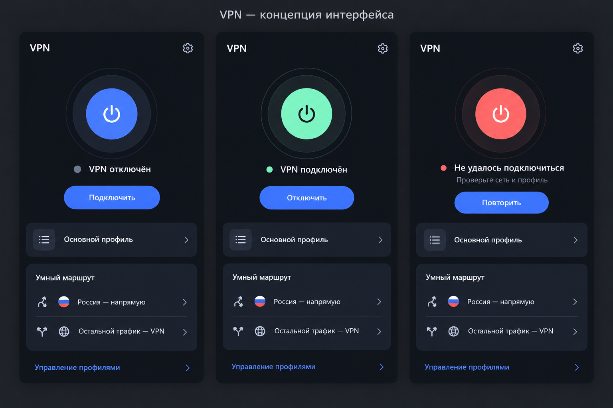

# Первый визуальный концепт Android VPN

Концепт для обсуждения, не скриншот текущего APK и не утверждённый дизайн.
Рабочее название — «VPN» до выбора имени. Серверные настройки не меняются.

## Направление

Спокойный тёмный интерфейс с крупной кнопкой включения в центре. Графитовый фон,
синий основной акцент, зелёный индикатор только при подтверждённом подключении.
Системная Android-типографика с поддержкой русского языка. Без карты мира,
рекламы и технических параметров на главном экране.

Главный экран: заголовок и настройки, текстовый статус, кнопка включения,
нейтральное имя активного профиля, карточка маршрутизации. В карточке явно указаны
исключения: «Россия — напрямую», «Остальной трафик — VPN». Никаких обещаний
полной анонимности или защиты всего трафика при включённых direct-правилах.

## Состояния

* Профиля нет: действие «Добавить профиль», ввод скрыт, успешный импорт не запускает VPN.
* Отключён: текст «VPN отключён», доступное действие «Подключить».
* Подключается: текст «Подключение…», действие отмены вместо повторного запуска.
* Подключён: текст «VPN подключён», действие «Отключить».
* Ошибка: понятное сообщение и повторная попытка; содержимое профиля и ошибка ядра
  с потенциальными ключами пользователю не отображаются.
* Ожидание и отсутствие прокси: отдельные состояния, не зелёное «подключён».

Состояния должны следовать существующему notifier/core, а не локальному таймеру
или анимации. Цвет дополняет текстовый статус. Нужны TalkBack, масштабирование
текста, контраст и кнопки с областью нажатия не менее 48 dp.

## Следующие макеты

После выбора направления: добавление профиля, безопасное управление профилями,
ошибка подключения, пустой экран и светлая тема. Визуальный концепт не заменяет
проверку Android permission, реального egress, DNS/IPv6 и поведения при смене сети.
Внедрение в Flutter — после проверки базового туннеля и обсуждения концепта.

## Визуальный макет v1

Изображение создано как концепт, а не скриншот работающего приложения. При реализации
круглая кнопка питания и текстовое действие должны образовывать одно доступное
основное действие, без двух конкурирующих кнопок. Строки маршрутизации информационные;
переходы по ним добавляются только при наличии соответствующих настроек.
